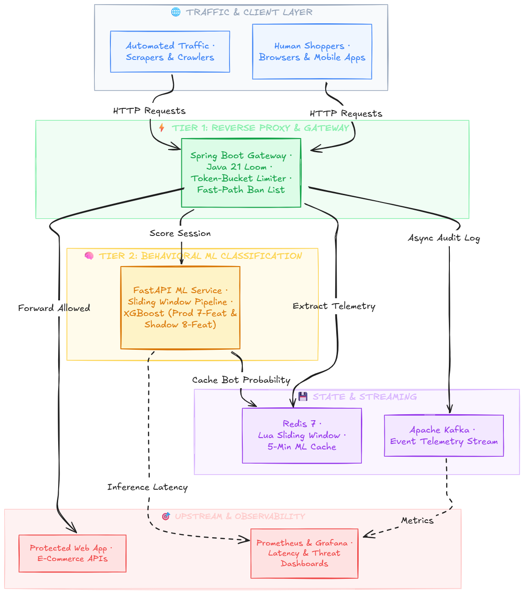

# SAGE: Sequence-Aware Gateway Engine (V2)

**SAGE** (Sequence-Aware Gateway Engine) is a high-throughput, behavioral machine-learning bot detection reverse proxy for modern e-commerce web applications.

Rather than relying on brittle client fingerprints, IP blacklists, or User-Agent rules that are trivially bypassed by modern attackers, SAGE classifies traffic **purely through session-level behavioral and macro-timing features** using a binary XGBoost classifier.

[](https://github.com/ayushcodes27/sage-engine/actions/workflows/ci.yml)

---

## Table of Contents

1. [Architecture Overview](#1-architecture-overview)
2. [Tech Stack](#2-tech-stack)
3. [Behavioral Feature Contract](#3-behavioral-feature-contract)
4. [Key Experimental Results & Evaluation](#4-key-experimental-results--evaluation)
5. [Adversarial Robustness & Pre-Registered Negative Result](#5-adversarial-robustness--pre-registered-negative-result)
6. [Getting Started & Local Deployment](#6-getting-started--local-deployment)
7. [Running Validations & Evaluations](#7-running-validations--evaluations)
8. [Governance & Auditing](#8-governance--auditing)

---

## 1. Architecture Overview

SAGE implements a strict **two-tier architecture** that cleanly separates infrastructure capacity protection from threat classification:

1. **Infrastructure Tier (Reverse Proxy & Rate Limiter)**: Built on Java 21 Virtual Threads and Redis Lua scripts. Handles generic token-bucket rate limiting for capacity protection and maintains temporary ban lists as enforcement memory. It **never** uses signatures, IP prefixes, or User-Agent heuristics to classify bots.
2. **Behavioral ML Tier (Decoupled Python/FastAPI)**: Serves as the sole classification authority. Extracts rolling sliding-window behavioral features and macro-scale inter-arrival timing metrics to output real-time bot probabilities.



```text
Incoming HTTP Request
       |
       +---> Tier 1: Generic Token-Bucket Rate Limiter     [Capacity Protection]
       |
       +---> Tier 2: Fast-Path Filter (Temporary IP Bans)  [Enforcement Memory]
       |
       +---> Sliding-Window Telemetry Pipeline (Redis Stream)
       |           |
       |           +---> Extracts 7/8 Behavioral & Timing Features
       |
       +---> ML Inference Service (Binary XGBoost)         [Sole Classification Authority]
                   |
                   +---> Production Model : sage_binary_v1      (7 Features)
                   +---> Active Shadow Model: timing-v1         (8 Features + Macro-Timing)
```

---

## 2. Tech Stack

| Layer | Technology |
|---|---|
| **Gateway / Reverse Proxy** | Java 21, Spring Boot, Spring Cloud Gateway, Virtual Threads (Project Loom) |
| **Machine Learning & Pipeline** | Python 3.11+, XGBoost, Scikit-learn, FastAPI, Pandas, NumPy, SciPy |
| **State & Streaming** | Redis 7 (Lua token bucket), Apache Kafka (telemetry event stream) |
| **Monitoring & Observability** | Prometheus, Grafana |
| **Testing & Traffic Generation** | Locust, Puppeteer Stealth, Playwright, Python ThreadPool Harness |
| **CI** | GitHub Actions (Java + Python tests, model integrity check) |

---

## 3. Behavioral Feature Contract

SAGE evaluates sessions based on canonical navigation patterns across a rolling sliding window (up to **50 non-static requests**, **5-minute inactivity timeout**):

| Feature | Description | Role in Detection |
|---|---|---|
| `SAGE_Session_Depth` | Count of non-static requests in the rolling window | Enforces minimum scoring gate (> 20 requests) |
| `SAGE_Temporal_Variance` | Coefficient of variation (std / mean) of inter-arrival times (IAT) | Flags unnaturally uniform or robotic delays |
| `SAGE_Request_Velocity` | Requests per second over active session duration | Identifies volumetric velocity bursts |
| `SAGE_Behavioral_Diversity` | Shannon entropy of visited canonical paths | Detects repetitive scraping loops vs. organic exploration |
| `SAGE_Endpoint_Concentration` | Proportion of requests hitting the most frequent endpoint | Detects single-resource hammering or pricing sweeps |
| `SAGE_Cart_Ratio` | Ratio of cart/checkout requests to total requests | Signals intentional conversion behavior vs. pure scraping |
| `SAGE_Asset_Skip_Ratio` | Proportion of non-static to total requests | Flags scrapers that skip CSS/JS/image asset downloads |
| `SAGE_NonStatic_Navigation_Gap` | Median IAT (seconds) between non-static requests | Differentiates human reading dwell time from automation |
| `SAGE_NonStatic_Long_Gap_Ratio` | Fraction of IAT intervals >= 500 ms | Captures human reading pauses vs. robotic pacing |

---

## 4. Key Experimental Results & Evaluation

SAGE V2 is validated across **three independent evaluation axes** with exact **95% Clopper-Pearson confidence intervals (CI)**. For full data tables and analysis, see [`PAPER_RESULTS.md`](PAPER_RESULTS.md).

### Summary Table

| Evaluation Axis | Dataset / Target | Model | Bot Recall (95% CI) | Human FPR (95% CI) | Outcome |
|---|---|---|---|---|---|
| **Axis 1: Offline Holdout** | `ScienceDirect.com` — ECLog, 1,202 clients | 8-Feat Timing XGBoost | **95.87%** (94.6%–96.9%) | **1.21%** (0.7%–1.9%) | +6.31% recall gain from macro-timing |
| **Axis 2: Cross-Site Domain Shift** | `zanbil.ir` — 10.36M real requests | 8-Feat Timing XGBoost | **76.80%** (73.5%–79.9%) | **14.21%** (13.6%–14.8%) | 93–100% recall on Googlebot, Bingbot, MJ12bot |
| **Axis 3: Live 350-Client Shadow** | Live Gateway (`diverse-8881bc1c` / `diverse-ba1a90e8`) | 8-Feat Shadow Model | **60.67%–66.67%** (Macro) | **0.00%** (0.00%–1.83%) | **NEGATIVE RESULT** — gates FAILED, enforcement stays DISABLED |
| **Model Selection** | ECLog Holdout | XGBoost vs. Random Forest | **94.88% Acc** (XGB) vs. 93.12% (RF) | N/A | XGBoost: **10x lower inference latency (0.18 ms)** |

---

## 5. Adversarial Robustness & Pre-Registered Negative Result

SAGE V2 enforces a strict scientific principle: **if pre-registered safety gates fail under live controlled validation, the campaign is reported as a negative result and enforcement is kept disabled.**

### Pre-Registered Safety Gate Evaluation (Live 350-Client Campaign)

| Gate | Threshold | Observed | Result |
|---|---|---|---|
| Scoring Coverage | >= 100.00% | **97.43%** (341/350 clients) | **FAILED** |
| Macro-Average Bot Recall | >= 90.00% | **60.67%–66.67%** | **FAILED** |
| Human FPR | <= 1.00% | **0.00%** (0/200 false positives) | **PASSED** |

**Conclusion:** Enforcement is strictly kept disabled (`ENFORCEMENT_ENABLED=false`).

### Evasion Profile Breakdown

| Profile | Evasion Technique | Detection | Engineering Analysis |
|---|---|---|---|
| **`slow_scraper`** | Residential IP rotation, random 3–7 s jitter | **100.00% Recall** | Caught by non-static navigation gap and temporal variance anomalies |
| **`fast_scraper`** | High-velocity API navigation | **100.00% Recall** | Identified by velocity bursts and endpoint concentration |
| **Commercial Crawlers** | `Googlebot`, `Bingbot`, `MJ12bot` (Zanbil.ir) | **92.9%–100.0% Recall** | Identified by high behavioral diversity and systematic crawl sequencing |
| **`asset_fetching_bot`** | Faithfully fetches all CSS/JS assets per page | **0.00% Recall (Evaded)** | **Architectural Gap**: server-side asset ratios match standard browsers when all assets are downloaded |
| **Headless Stealth Browser** | Puppeteer Stealth + randomized bezier mouse paths | **Evaded ML layer** | Full-browser execution is indistinguishable from humans without client-side attestation |

---

## 6. Getting Started & Local Deployment

### Prerequisites

- Docker & Docker Compose (v2.20+)
- Java 21 JDK
- Python 3.11+

### Quick Start (Docker Compose)

```bash
# 1. Clone the repository
git clone https://github.com/ayushcodes27/sage-engine.git
cd sage-engine

# 2. Start the full SAGE infrastructure stack
docker compose -f infra/docker-compose.yml up -d

# 3. Verify services are healthy
curl http://localhost:8083/actuator/health
curl http://localhost:8000/health
```

### Exposed Endpoints

| Service | URL |
|---|---|
| **SAGE Gateway** | `http://localhost:8083` |
| **SAGE ML Service** | `http://localhost:8000` — `/health` returns active model SHA-256 & contract hash |
| **Mock Target App** | `http://localhost:3030` (direct) · `http://localhost:8083/products` (via gateway) |
| **Kafka UI** | `http://localhost:8090` |
| **Grafana Dashboard** | `http://localhost:5050` |
| **Prometheus** | `http://localhost:9091` |
| **RedisInsight** | `http://localhost:5540` |

---

## 7. Running Validations & Evaluations

```bash
# 0. Cryptographically verify frozen models & contracts (tag v2-frozen-models-v6)
python ml_pipeline/scripts/evaluate/verify_frozen_manifests.py

# 1. Run automated test suites
pytest ml_pipeline                      # Python ML unit & parity tests (13 tests)
cd sage-gateway && mvn test             # Java Spring Gateway test suite (17 tests)

# 2. Run Zanbil.ir 10.36M cross-site evaluation
python ml_pipeline/scripts/evaluate/evaluate_zanbil_crosssite.py \
  --access-log   ml_pipeline/data/access.log \
  --hostname-csv ml_pipeline/data/client_hostname.csv \
  --timing-model ml_pipeline/models/eclog_timing_binary_model.pkl \
  --sixfeat-model ml_pipeline/models/eclog_6feature_binary_model.pkl \
  --report       ml_pipeline/reports/zanbil_crosssite_evaluation.md \
  --results-json ml_pipeline/reports/zanbil_crosssite_results.json

# 3. Run 350-client live shadow traffic campaign
python load-tests/diverse-shadow-traffic.py

# 4. Collect telemetry and generate statistical report
python ml_pipeline/scripts/data/collect_shadow_telemetry.py \
  --output load-tests/telemetry.jsonl

python ml_pipeline/scripts/evaluate/evaluate_shadow.py \
  --telemetry load-tests/telemetry.jsonl \
  --manifest  load-tests/diverse_manifest.json \
  --report    load-tests/diverse_report.md
```

---

## 8. Governance & Auditing

All project development, model freezing, evaluation runs, and validation decisions are immutably logged in [`AUDIT_LEDGER.md`](AUDIT_LEDGER.md) and tracked against [`SAGE_PHASE2_ROADMAP.md`](SAGE_PHASE2_ROADMAP.md).

The CI pipeline (`.github/workflows/ci.yml`) automatically enforces:
- Java Gateway compilation and full test suite
- Python ML unit & parity tests (`pytest ml_pipeline`)
- Model integrity verification (SHA-256 manifest check)
